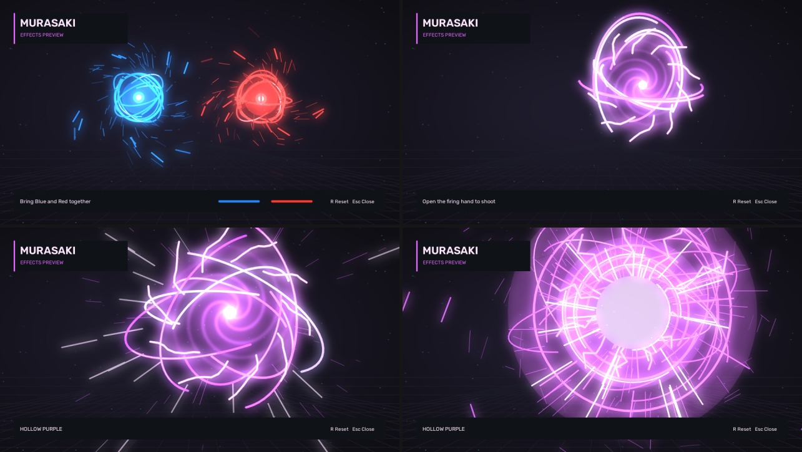
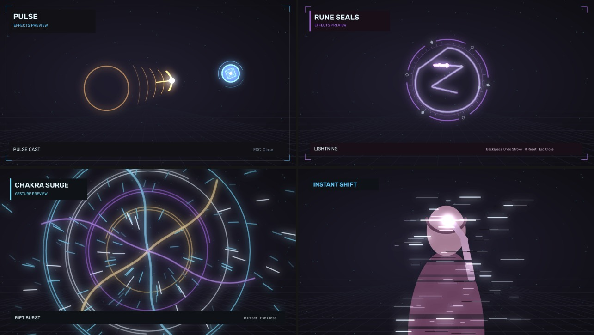

# Arcane Signal

Arcane Signal is a Python webcam demo that turns hand gestures into animated spells. Raise your hands to summon energy, draw a rune in the air, or combine two glowing cores into Hollow Purple. The app selects spells automatically and processes camera frames locally.



## Get started

The demo was tested on Windows with Python 3.11. Use a webcam for live gestures, or start with the camera-free preview.

```powershell
git clone https://github.com/Nathann-12/arcane-signal.git
cd arcane-signal
py -3.11 -m venv .venv
.\.venv\Scripts\python.exe -m pip install -r requirements.txt
.\.venv\Scripts\python.exe arcane.py
```

The first live run downloads the hand and face tracking models into `.cache/`. Use `--camera 1` to select a second camera if one is connected.

### Preview without a camera

```powershell
.\.venv\Scripts\python.exe arcane.py --preview
.\.venv\Scripts\python.exe arcane.py --purple --preview
```

The first command cycles through the spells. The second goes straight to Murasaki. The screenshots in this README come from the camera-free preview.

## Cast a spell

Left and right refer to the **mirrored picture on screen**. Hold the starting gesture briefly. After a spell finishes, the app returns to automatic selection.

| Spell | How to cast |
| --- | --- |
| **Murasaki (Hollow Purple)** | Open your palm on the left side of the screen and point with your index finger on the right. Bring the Blue and Red cores together. Keep pointing with the hand holding the purple orb, then open that hand to fire the orb toward the camera. |
| **Rune Seals** | Hold a thumb-and-index pinch, then trace a circle. Release to move your hand and pinch again inside the ring. Draw a hook for Vortex or a Z for Lightning. Open your palm briefly to cast. |
| **Pulse** | Raise two fingers on one hand. Tilt your hand to charge, then open your palm to send a pulse toward the floating orb. |
| **Palm Vortex** | Open one palm and turn it about 45 degrees, like turning a clock face. The effect follows the direction of the turn. If you captured an empty room with **B**, the spell ends with a teleport. |
| **Chakra Surge** | Bring two open palms close together with a small gap. Separate them slightly and hold until the meter reads 100%. Spread them farther apart to fire a chakra shot. Move one hand farther than the other to aim toward that side. |
| **Chakra Overdrive** | At 100%, raise one hand and lower the other to tilt the line between them by about 45 degrees. Keep roughly the same gap while tilting. When **Overdrive** appears, spread your hands to release the Rift Burst. |
| **Instant Shift** | Press **B**, step out of frame, and wait for the gesture menu to return. Step back in and hold your index and middle fingers against your forehead briefly. Your image vanishes into the captured background, then reappears. |

For Rune Seals, pinch near the gold marker to resume a paused stroke. For Instant Shift, recapture the empty frame if you move the camera or change the scene. The room image stays in memory for the live session.

| Key | Action |
| --- | --- |
| **R** | Reset the current spell and return to selection |
| **Backspace** | Clear the current rune stroke |
| **B** | Capture an empty room in automatic mode |
| **Esc** or **Q** | Close the app |

Use `--runes`, `--pulse`, `--chakra`, or `--purple` to open one mode directly.



## Run the tests

```powershell
.\.venv\Scripts\python.exe -m unittest -v
```

## Audio credit

The default teleport sound combines synthesized audio with [Teleport - darker by GameAudio](https://freesound.org/people/GameAudio/sounds/220205/) (CC0). To use your own recording, place a PCM WAV file at `assets/teleport-original.wav`. That local override is ignored by Git.
